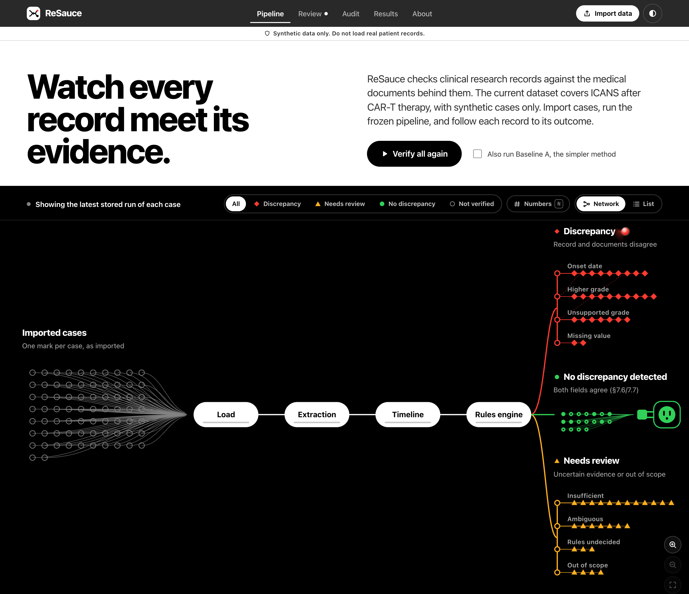
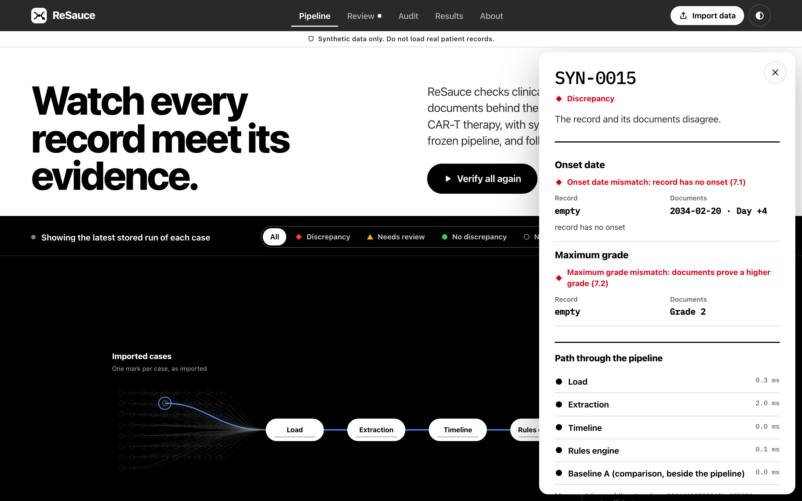
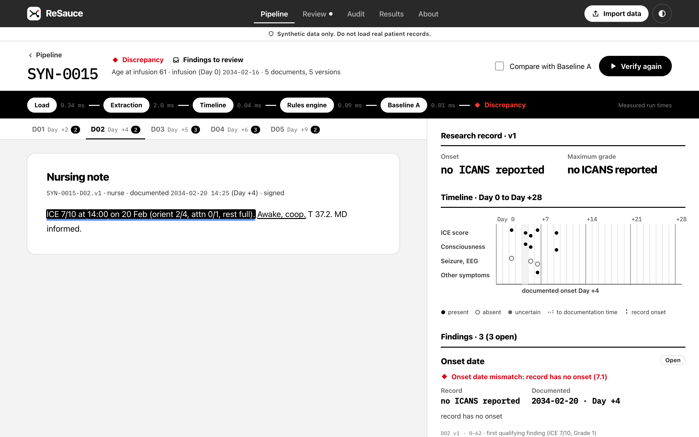
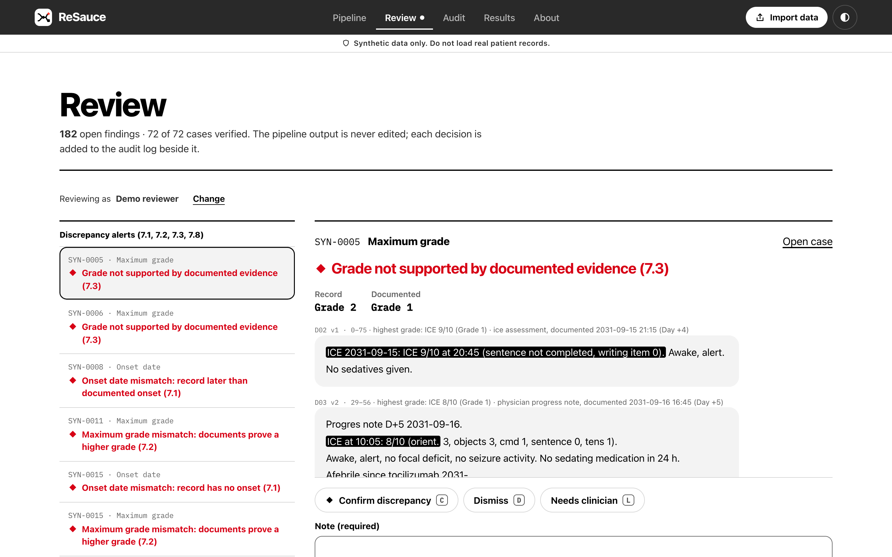
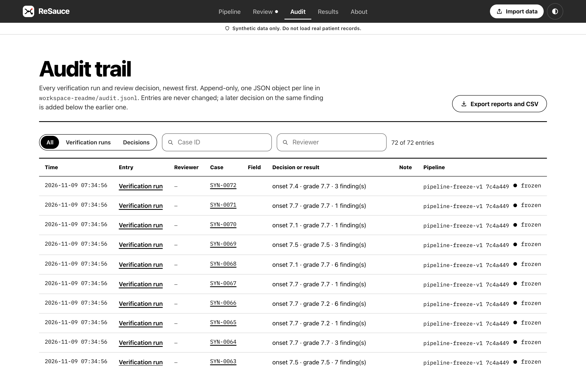
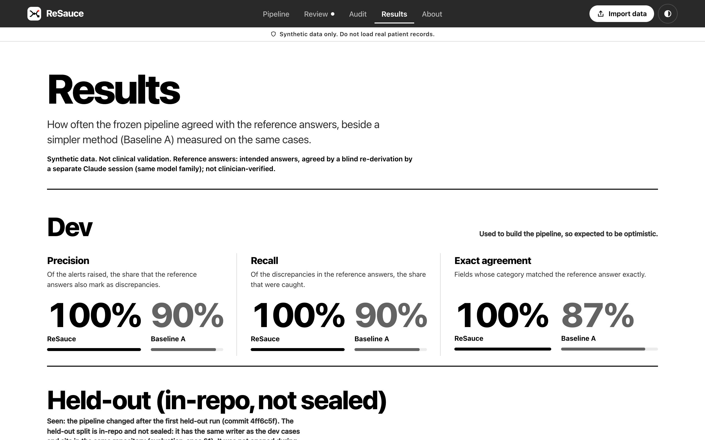
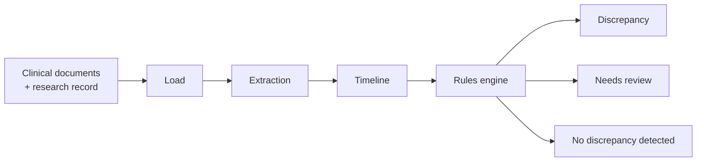

<div align="center">


# ReSauce

**Checks clinical research records against the medical documents behind them.**

Every finding is traced to the exact quoted text it rests on.<br>
Current dataset: ICANS after CAR-T cell therapy (synthetic cases only).


[Overview](#overview) · [Screenshots](#screenshots) · [How it works](#how-it-works) · [Results](#results) · [Quick start](#quick-start) · [Limitations](#limitations)

</div>

<br>

<picture>
  <source media="(prefers-color-scheme: dark)" srcset="docs/images/pipeline-dark.png">
  
</picture>

> [!IMPORTANT]
> ReSauce is a research proof of concept. It is **not** a medical device and **not** a clinical decision tool. It works only with synthetic (made-up) data and must never be given real patient data. Results on synthetic data are not clinical validation.

---

## Overview

Clinical research databases are filled in by people reading medical notes and copying values into a research record. If a date or a severity grade is copied wrongly, the error goes into the study. Checking for this usually means reading the notes again by hand.

ReSauce does that check with computer code. It reads the clinical documents behind a research record, finds the observations that matter, rebuilds the timeline of events, and compares the record with what the documents support. Every potential discrepancy is shown with the exact quoted text it comes from, so a person can review it.

**Aim and current scope.** ReSauce is meant to check clinical research records in general. The current version covers one use case: **ICANS** (immune effector cell-associated neurotoxicity syndrome), a neurological complication that can follow CAR-T cell therapy. For each case it checks two fields of the research record, the **ICANS onset date** and the **maximum ICANS grade**, against 72 synthetic cases. The rules for any other condition or field have not been written yet.

### Design principles

| Principle | What it means in practice |
|---|---|
| **Traceable evidence** | Every observation keeps its document ID, document version, character position and exact quote. Clicking a finding opens the source text at that spot. |
| **Two kinds of time** | The time an event happened is kept apart from the time it was written down, so a note written on Day 5 about Day 3 is dated Day 3. |
| **Uncertainty is shown** | If the rules cannot decide, the result is "needs human review", never a guess. Missing evidence is not treated as absent evidence. |
| **Fixed, written rules** | The pipeline uses deterministic rules (no machine learning). Each rule is written out in [`docs/clinical-methods.md`](docs/clinical-methods.md). |
| **Measured against a simpler method** | Results are compared with Baseline A, a careful conventional check, scored on the same cases in the same way. |
| **Local and reproducible** | The app runs only on your own computer and makes no network calls. Each run records the pipeline version and file fingerprints, and every review decision goes into an append-only audit log. |

---

## Screenshots

### Inspect a case

Click any case on the pipeline to see its two fields, the value in the record beside the value in the documents, its path through each stage with measured times, and every finding.



### Check the evidence

The case page shows the documents, the research record and the reconstructed timeline (Day 0 to Day +28). Clicking a finding opens the document and highlights the exact text it rests on.



### Review findings

Open findings are listed most serious first. For each one the reviewer confirms, dismisses or sends it to a clinician, with a required note. Keyboard shortcuts make long sessions faster.



### Audit trail and results

<table>
  <tr>
    <td width="50%"></td>
    <td width="50%"></td>
  </tr>
  <tr>
    <td>Every run and decision is logged with its time, reviewer and pipeline version. Reports and a CSV can be exported.</td>
    <td>Headline results of the stored evaluation, ReSauce beside Baseline A, with their caveats.</td>
  </tr>
</table>

---

## How it works



1. **Load.** Read a case: every version of every clinical document, every version of the research record, and the observation window (Day 0 is the infusion; the window runs to Day +28).
2. **Extraction.** Find the relevant observations in the text: ICE scores (a 10-point bedside screen of orientation, naming, following commands, writing and attention), level of consciousness, seizures, motor signs, signs of raised brain pressure, symptoms, competing causes and "could not be assessed" statements. Each is marked present, absent or uncertain and keeps its exact quote and position.
3. **Timeline.** Rebuild the order of events. Event time is kept apart from documentation time, and signed, unsigned and replaced document versions are handled.
4. **Rules engine.** Work out the onset date and maximum grade the documents support (ASTCT grading, [`docs/clinical-methods.md`](docs/clinical-methods.md) §3), compare them with the record, and put each field into a category.

### Discrepancy categories

Defined in [`docs/clinical-methods.md`](docs/clinical-methods.md) §7. Each case lands in one destination on the pipeline view, decided only by its two field categories.

| Code | Category | Destination |
|---|---|---|
| 7.1 | Onset date mismatch | Discrepancy |
| 7.2 | Maximum grade mismatch | Discrepancy |
| 7.3 | Grade not supported by documented evidence | Discrepancy |
| 7.8 | Missing recorded value | Discrepancy |
| 7.4 | Insufficient evidence (missing is not the same as absent) | Needs review |
| 7.5 | Ambiguous evidence | Needs review |
| "review: …" | A rule the engine cannot decide | Needs review |
| 7.6 | Legitimate revision (not an error) | No discrepancy detected |
| 7.7 | No discrepancy | No discrepancy detected |

A case lands in **No discrepancy detected** only when both fields are 7.6 or 7.7. Cases that are out of scope, or have a category the app does not recognise, go to **Needs review**.

---

## Results

Quoted from [`results/report.md`](results/report.md). Counts are fields (onset date and maximum grade together). The two splits are reported separately and never pooled.

> [!NOTE]
> All data is synthetic. Reference answers are "intended answers, agreed by a blind re-derivation by a separate Claude session (same model family); not clinician-verified". These are not clinical validation results.

**Dev split (20 cases).** Used to build and debug the pipeline, so these numbers are expected to be optimistic.

| Method | Precision | Recall | F1 | Exact agreement | Misses | False alerts |
|---|---|---|---|---|---|---|
| ReSauce | 1.00 (10/10) | 1.00 (10/10) | 1.00 (20/20) | 1.00 (38/38) | 0 | 0 |
| Baseline A | 0.90 (9/10) | 0.90 (9/10) | 0.90 (18/20) | 0.87 (33/38) | 1 | 1 |

**Held-out split (52 cases).** In the repository, not sealed, and "seen": the pipeline changed after the first held-out run (commit `4ff6c5f`). It has the same writer as the dev cases, so it is not an independent test.

| Method | Precision | Recall | F1 | Exact agreement | Misses | False alerts | "review: …" results |
|---|---|---|---|---|---|---|---|
| ReSauce | 0.84 (16/19) | 0.80 (16/20) | 0.82 (32/39) | 0.86 (84/98) | 4 | 3 | 5 |
| Baseline A | 0.61 (14/23) | 0.70 (14/20) | 0.65 (28/43) | 0.65 (64/98) | 6 | 9 | 0 |

- **Out of scope** (ReSauce only; Baseline A cannot flag it): dev 1 of 1 and held-out 3 of 3 flagged, each with the reference's reason.
- **Evidence-quote validity:** 1.00 for both methods on both splits (every quoted reference matches its source text).
- **Baseline A** uses the same extraction but dates each finding by when it was written, uses only the latest document versions, and has no observation window or record history ([`docs/evaluation-spec.md`](docs/evaluation-spec.md) §4).
- **Not yet done:** Baseline B (a language model) has not been run. The locked test set has not been evaluated, so no locked-set numbers exist.

---

## Quick start

**Requirements:** Python 3.13 or newer (`python3 --version`) and Git. Nothing else: the built web page is included in the repository.

```bash
git clone https://github.com/shreyandhawa/ReSauce.git && cd ReSauce
python3 -m venv .venv            # create a private Python environment in .venv/
source .venv/bin/activate        # use it in this terminal; the prompt starts with (.venv)
pip install -e ".[dev]"          # install ReSauce and its test tool (pytest)
python -m app                    # start the workstation
```

Open **http://localhost:8000**, press **Import data**, then **Import examples** to copy the 72 synthetic cases, then **Verify all cases**. Stop the app with `Ctrl+C`.

In every new terminal, run `source .venv/bin/activate` first.

---

## Using the workstation

The workstation is a local web app. It listens only on this computer (`127.0.0.1`), makes no network calls and works offline. It keeps its data in a **workspace folder** (default `workspace/`, never committed to Git) holding your cases, every run, the audit log and exports.

| Step | What to do |
|---|---|
| **1. Import** | **Import data** offers three options: **Import examples** (copies the 72 cases from `data/dev-v1`; the originals are only read), **a folder in this project**, or **Enter a case by hand** (a form for case details, documents and record values, checked by the pipeline's own loader before saving). |
| **2. Verify** | **Verify all cases** runs each case through the frozen pipeline. Cases move across the stage as their real results arrive, slowed down so the run can be followed (**Pause** and **Show result now** control this). Tick **Also run Baseline A** to run the simpler method too. |
| **3. Inspect** | Click any case to open the inspector. **Open case** shows the documents: click a quote to jump to it in the text. Press **Numbers** (or `N`) for counts and measured stage times; **List** shows the same cases as a table. |
| **4. Review** | **Review** lists open findings, most serious first. Choose **Confirm discrepancy**, **Dismiss** or **Needs clinician** and write a note. A decision never changes the pipeline's output; it is stored beside it. |
| **5. Audit** | **Audit** shows every run and decision with time, reviewer, case, field, note and pipeline version, stored append-only in `workspace/audit.jsonl`. |
| **6. Export** | **Export reports and CSV** writes a printable case report (print it to PDF from the browser) and a CSV of all findings and decisions to `workspace/exports/`. |

**Keyboard shortcuts in Review**

| Key | Action |
|---|---|
| `J` / `K` | Next / previous finding |
| `C` / `D` / `L` | Confirm / Dismiss / Needs clinician, then jump to the note |
| `Ctrl`+`Enter` (`⌘`+`Enter` on Mac) | Record the decision |

**Command-line options**

| Option | Purpose |
|---|---|
| `--port 8001` | Use another port if 8000 is taken |
| `--workspace my-workspace` | Use another workspace folder (it must be inside the project folder) |
| `--results <file> --data <folder> --reference <folder>` | Add another results file to the Results page without code changes |

<details>
<summary><b>Changing the web page</b> (development only)</summary>

<br>

This needs Node.js (an LTS version). The built page in `web/dist/` is what the app serves.

```bash
cd web
npm install        # once
npm run build      # rebuild web/dist/ after a change
npm run dev        # optional: live-reloading page at http://localhost:5173 (keep python -m app running)
```

</details>

---

## Evaluation and tests

```bash
pytest                          # run the test suite
python -m resauce.evaluate      # score ReSauce and Baseline A on the dev and held-out splits
```

> [!WARNING]
> `python -m resauce.evaluate` **overwrites** `results/report.md`, `results/dev.json` and `results/held_out.json`. Run it only when you intend a new, recorded run.

## Reproducibility

- **Frozen pipeline.** The pipeline code is frozen at Git tag `pipeline-freeze-v1` ([`docs/freeze.md`](docs/freeze.md)). `tests/test_freeze.py` checks that the frozen files have not changed.
- **Versioned runs.** Every run stores the tag, the commit and the SHA-256 fingerprint of each frozen file, and whether they match the freeze record.
- **Decisions tied to output.** Each review decision is keyed to a fingerprint of the exact output it was made on. If a re-run gives a different output, its findings reopen instead of silently inheriting old decisions.
- **Recorded methods.** Scoring rules are in [`docs/evaluation-spec.md`](docs/evaluation-spec.md); clinical rules and assumptions are in [`docs/clinical-methods.md`](docs/clinical-methods.md).

---

## Limitations

- All data is synthetic. Results are not clinical validation.
- Cases and reference answers were written by Claude sessions. A blind re-derivation by another Claude session agreed on every category, but both come from the same model family and the same rules text: this shows the rules are applied consistently, not that either is clinically right. No clinician has verified them.
- A clinician has not yet reviewed the assumptions A1–A35 in [`docs/clinical-methods.md`](docs/clinical-methods.md) or the rule gaps in [`reference/dev-v1/comparison.md`](reference/dev-v1/comparison.md) §8.
- The held-out split is not sealed and is "seen"; the dev split was used to build the pipeline.
- The extractor's phrase lists were built from the 20 dev cases and `docs/clinical-methods.md` only. Some misspellings are listed for review; others (swapped letters, short words) are missed without a warning.
- Rules that are not built return "review: …" (needs human review), never a guess.
- Each case holds 3 to 12 documents, so most days in the window have no documented assessment, and the "unassessed period" lists are long by design.
- Only ICANS onset date and maximum grade are covered. Other conditions and fields would need new written rules and new synthetic data.
- Baseline B is not run. The locked set is not evaluated.

The full list, with sources, is on the app's **About** page and in [`docs/evaluation-spec.md`](docs/evaluation-spec.md) §6.

---

## Project layout

```
src/resauce/     the pipeline (frozen): loader, extraction, timeline, rules engine, Baseline A, evaluation
app/             the workstation's local server (Python standard library only); it calls src/, never the reverse
web/             the workstation's web page (Vite + React); web/dist/ is the built page
data/dev-v1/     72 synthetic cases
reference/       reference answers and splits
results/         evaluation results (report.md, dev.json, held_out.json)
docs/            clinical methods, data format, evaluation spec, freeze record, handoff log, images
tests/           automated tests
workspace/       your workspace (created on first start; git-ignored)
```

## Documentation

| Document | Contents |
|---|---|
| [`docs/clinical-methods.md`](docs/clinical-methods.md) | ICANS grading, time rules, discrepancy categories and assumptions |
| [`docs/data-format.md`](docs/data-format.md) | The case, document and research record format |
| [`docs/dataset-plan.md`](docs/dataset-plan.md) | How the synthetic dataset was planned |
| [`docs/evaluation-spec.md`](docs/evaluation-spec.md) | Scoring, Baseline A and Baseline B, limitations |
| [`docs/freeze.md`](docs/freeze.md) | The pipeline freeze record |
| [`docs/handoff.md`](docs/handoff.md) | Development log |

## Data and licence

- **Data:** synthetic only, written for this project. Every file carries the notice "FICTIONAL SYNTHETIC DATA. NOT A REAL PATIENT." Never add real patient data.
- **Licence:** no licence has been chosen yet.
- **Fonts:** the bundled IBM Plex Mono is under the SIL Open Font Licence. All other text uses the computer's own system font.
